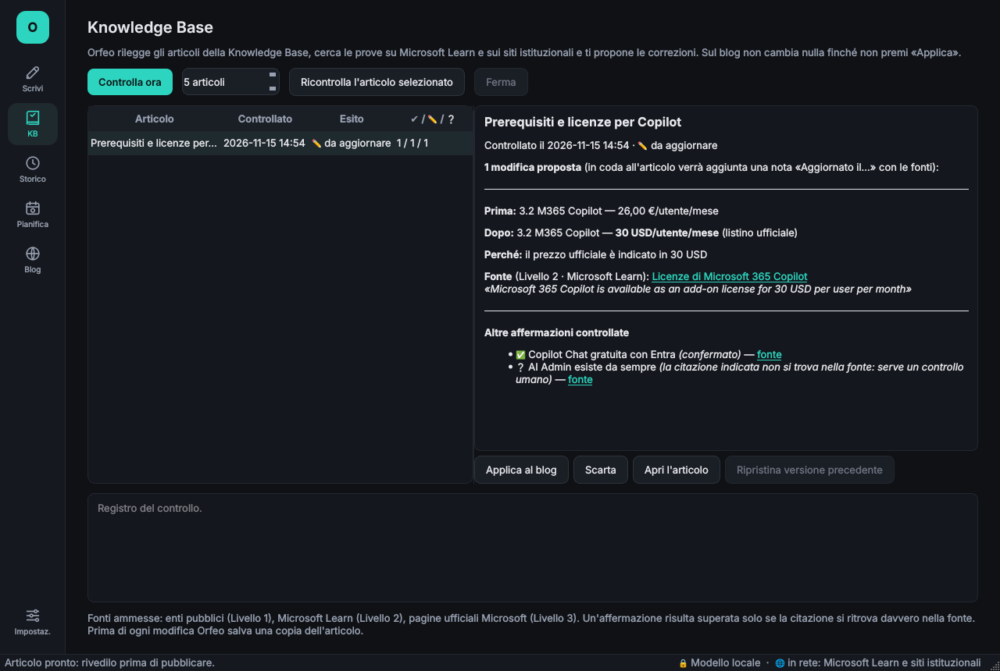
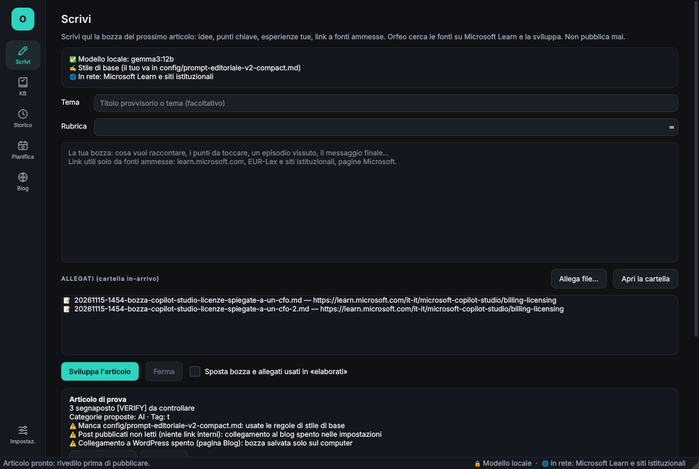
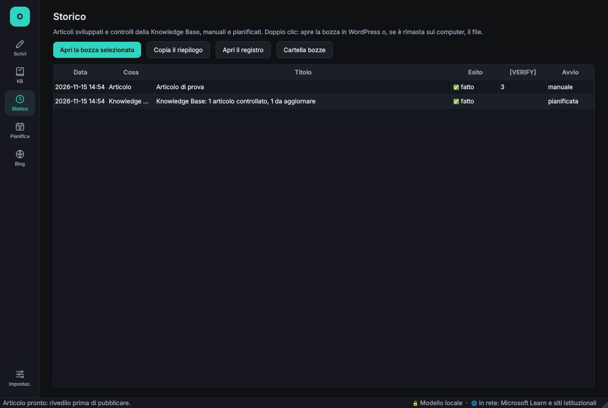
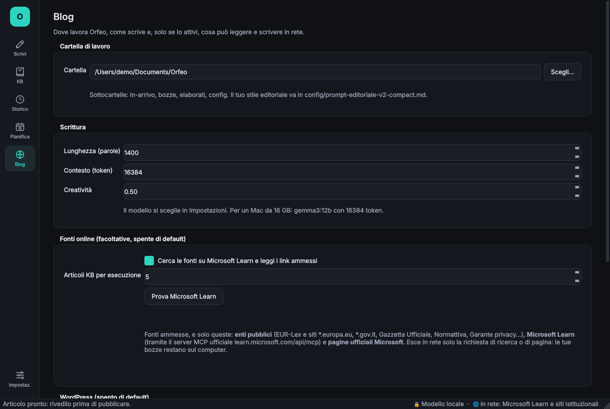

# Orfeo · l'agente editoriale di argosnewdreams.blog

**Tiene aggiornata la Knowledge Base del blog e sviluppa le tue bozze in articoli, con un modello linguistico che gira sul tuo computer. Le fonti sono solo istituzionali e Microsoft ufficiali; l'ultima parola è sempre tua.**
*A local editorial agent: keeps the blog's knowledge base up to date and turns your drafts into articles. Official sources only, nothing changes without your approval. English summary below.*

Fa parte della famiglia [Argo](https://github.com/Argo-s-new-dreams/argo-ai): stessa interfaccia «Studio», stesso installer, aggiornamenti dall'app.



## Funzionalità

| Pagina | Cosa fa | Motore |
| --- | --- | --- |
| **Scrivi** | Incolli la tua bozza (tema, rubrica, punti, link): Orfeo cerca le fonti su Microsoft Learn e la sviluppa in un articolo completo, salvato come bozza | LLM via Ollama + Microsoft Learn MCP |
| **Knowledge Base** | Rilegge gli articoli della Knowledge Base (BasePress), trova le affermazioni superate e propone le correzioni con fonte e citazione; **Applica**, **Scarta**, **Ripristina** | LLM via Ollama + Microsoft Learn MCP |
| **Storico** | Articoli sviluppati e controlli della Knowledge Base, con registro di ogni esecuzione | Locale |
| **Pianifica** | Ogni settimana: controllo della Knowledge Base e notifica che ti chiede la bozza del prossimo articolo | launchd (macOS), Utilità di pianificazione (Windows) |
| **Blog** | Cartella di lavoro, lunghezza e stile; accessi in rete **facoltativi** (fonti online, WordPress) | — |
| **Impostazioni** | Tema, modello Ollama, aggiornamenti | — |

| Scrivi | Storico | Blog |
| --- | --- | --- |
|  |  |  |

## Le fonti: solo istituzionali e Microsoft ufficiali

Un elenco chiuso, controllato dal codice prima di ogni lettura e di ogni citazione:

| Livello | Fonti |
| --- | --- |
| **1 · Ente pubblico** | EUR-Lex e siti `*.europa.eu`, siti `*.gov.it`, Gazzetta Ufficiale, Normattiva, Garante privacy, Senato, Camera, Banca d'Italia, Consob, Istat, siti `.gov` |
| **2 · Microsoft Learn** | `learn.microsoft.com`, interrogato con il [Microsoft Learn MCP Server](https://learn.microsoft.com/training/support/mcp) ufficiale |
| **3 · Microsoft ufficiale** | altre pagine `microsoft.com` (roadmap, siti di prodotto), `azure.com`, `office.com` |

Un link fuori elenco viene ignorato e segnalato. Solo `https`; i domini sosia (es. `learn.microsoft.com.esempio.com`) sono rifiutati.

## Le garanzie sono nel codice, non nel prompt

- **Knowledge Base: nulla cambia senza il tuo «Applica».** Il solo codice che modifica contenuti pubblicati è `kb_applica.py`, importato soltanto dalla pagina Knowledge Base. Prima di scrivere rilegge l'articolo e rifiuta se è cambiato dopo il controllo; salva una copia di sicurezza; modifica solo il campo `content` (titolo, stato, categorie restano). **Ripristina** rimette la versione precedente.
- **Superata solo con la prova.** Un'affermazione risulta superata solo se la citazione indicata dal modello si ritrova parola per parola nella fonte; altrimenti è «da verificare». Ogni correzione riguarda un solo paragrafo, titolo, voce di elenco o cella; in coda Orfeo aggiunge la nota «Aggiornato il… Fonti: …».
- **Articoli nuovi: solo bozze, solo dalla tua bozza.** Orfeo non sceglie temi da solo. Su WordPress crea esclusivamente post `draft`.
- **Nessun link inventato.** Il modello cita le fonti come `[S1]`; i Riferimenti li compone Python con le pagine lette davvero. Ogni altro URL viene tolto e sostituito da `[VERIFY: link rimosso perché non verificato]`.
- **Niente si cancella.** Bozze e allegati usati vanno in `elaborati/AAAA-MM-GG/`; proposte applicate o scartate in `dati/kb/archivio/`.

## Il "cervello" testuale: Ollama

```bash
ollama pull gemma3:12b   # circa 8 GB: adatto a un Mac da 16 GB
```

Si scarica anche da *Impostazioni → Nuovo modello*. Con gemma3:12b su un Mac M4 un articolo richiede qualche minuto, il controllo di un articolo della Knowledge Base uno o due. Se Ollama è chiuso, Orfeo prova ad aprirlo da solo.

## Requisiti

| Sistema | Supporto |
| --- | --- |
| macOS Apple Silicon (M1 o successivi), 16 GB consigliati | Sì: notifiche nel Centro notifiche, pianificazione con launchd |
| Windows 10/11 x64 | Sì: pianificazione con l'Utilità di pianificazione, esito nello Storico (niente notifica) |
| Windows 11 ARM | Sì, con Python x64 in emulazione |
| macOS Intel, Linux | No |

## Installazione

1. **Scarica** il repository (`Code → Download ZIP`) ed estrailo.
2. **Avvia l'installer**
   - macOS: tasto destro su `Installa-Mac.command` → *Apri*. Se macOS lo blocca: *Impostazioni di Sistema → Privacy e sicurezza → Apri comunque*.
   - Windows: doppio clic su `Installa-Windows.bat`. Se compare SmartScreen: *Ulteriori informazioni → Esegui comunque*.
3. **Apri Orfeo**: in *Impostazioni* scegli il modello; in *Blog* attiva le fonti online e WordPress (utente e *password applicazione*), poi **Prova Microsoft Learn** e **Verifica collegamento**.
4. Primo controllo da **Knowledge Base → Controlla ora**, prima bozza da **Scrivi**; poi attiva la **Pianificazione** (di serie lunedì alle 7:40). Su Mac rispondi «Consenti» se chiede l'accesso a Documenti.

Gli installer non sono firmati digitalmente: per questo Windows e macOS mostrano un avviso. Il codice è tutto qui, leggibile.

🆕 **Novità:** [CHANGELOG.md](CHANGELOG.md) · 📖 **Manuale:** [docs/MANUALE.md](docs/MANUALE.md)

## Privacy e dati

- Il modello gira sul computer: **bozze e articoli non vengono mai inviati a un servizio di AI.**
- Di serie Orfeo **non va in rete** (a parte il controllo degli aggiornamenti su GitHub, disattivabile). Nella pagina *Blog* puoi accendere:
  - **Fonti online**: ricerche sul Microsoft Learn MCP Server (escono solo le parole cercate) e lettura delle pagine ammesse;
  - **WordPress**: lettura di post e Knowledge Base, creazione di bozze, modifiche alla Knowledge Base solo con **Applica**. Autenticazione con una *password applicazione* nel portachiavi del sistema (Portachiavi su macOS, Gestore credenziali su Windows).
- Il bollino in basso dichiara gli accessi attivi: «🔒 Modello locale · 🌐 in rete: …».
- Impostazioni, storico, registri, proposte e copie di sicurezza stanno in `~/orfeo-blog-env/dati/`; bozze e articoli nella cartella di lavoro (di serie `~/Documents/Orfeo`). Gli aggiornamenti non li toccano.

### AI Act

Orfeo è uno strumento di supporto alla scrittura e alla manutenzione dei contenuti: decide la persona che rivede, approva e pubblica.

- **Art. 50(4), Regolamento (UE) 2024/1689:** chi diffonde testo generato o manipolato dall'AI per informare il pubblico su questioni di interesse pubblico deve dichiararlo, salvo che il testo sia stato sottoposto a revisione umana o controllo editoriale e una persona ne abbia la responsabilità editoriale. Orfeo aggiunge comunque una nota di trasparenza agli articoli nuovi e la nota «Aggiornato il…» con le fonti agli articoli della Knowledge Base corretti.
- **Art. 4 (alfabetizzazione in materia di AI):** registro passo per passo, prova citata per ogni correzione, [VERIFY] e livelli delle fonti aiutano a capire cosa ha fatto il modello e dove serve il controllo umano.
- Nessuna funzione rientra fra le pratiche vietate dall'art. 5.

*Queste note non sono consulenza legale.*

## Struttura

```
app/
  progetto.py            identità dell'app (nome, versione, impostazioni di base)
  main.py                finestra, menu, Impostazioni, aggiornamenti, avvio senza finestra
  pagina_scrivi.py       Scrivi           pagina_kb.py         Knowledge Base
  pagina_storico.py      Storico          pagina_pianifica.py  Pianifica
  pagina_blog.py         Blog (cartella, scrittura, rete facoltativa)
  motore.py              dalla bozza all'articolo, senza interfaccia
  kb.py                  controllo della Knowledge Base e proposte (non modifica mai il blog)
  kb_applica.py          l'unico punto che modifica il blog: Applica e Ripristina
  fonti.py               elenco chiuso delle fonti ammesse, livelli, controllo delle citazioni
  learn_mcp.py           client del Microsoft Learn MCP Server (SDK MCP ufficiale)
  wordpress.py           lettura di post e Knowledge Base, creazione di bozze
  ingressi.py, gutenberg.py, pianificazione.py, comune.py, ui_comune.py
  tema.py, pagine.py, lavoro.py, dati.py, llm_locale.py, aggiornamenti.py   standard famiglia Argo
docs/                    manuale e screenshot
strumenti/               versione, icone, verifica pre-pubblicazione
```

## Stato del progetto

Collaudato con server simulati (Ollama, WordPress e Microsoft Learn MCP); da collaudare sul Mac M4 e sul PC Windows ARM con Ollama, gemma3:12b, il Learn MCP Server reale e il blog.

## Licenza

MIT. Licenze di terze parti in [THIRD_PARTY_LICENSES.md](THIRD_PARTY_LICENSES.md). Repository: [Argo-s-new-dreams/orfeo-blog](https://github.com/Argo-s-new-dreams/orfeo-blog).

## English summary

Orfeo is a local desktop app (macOS Apple Silicon and Windows) with two jobs. **Knowledge base upkeep:** it rereads the blog's knowledge base articles, extracts claims that may be outdated, looks for evidence on Microsoft Learn (through the official Learn MCP Server) and on public-institution sites, and proposes corrections; a claim counts as outdated only if the quoted evidence is actually found in the source, and nothing changes on the blog until the user clicks **Apply** (with backup, concurrency check and **Restore**). **Writing:** it turns the user's own draft into a full article, saved as a WordPress **draft**. Sources are restricted by code to public institutions, Microsoft Learn and official Microsoft pages. The LLM runs locally via Ollama; network access is optional and off by default. A weekly schedule runs the knowledge base check and asks the user for the next draft.
