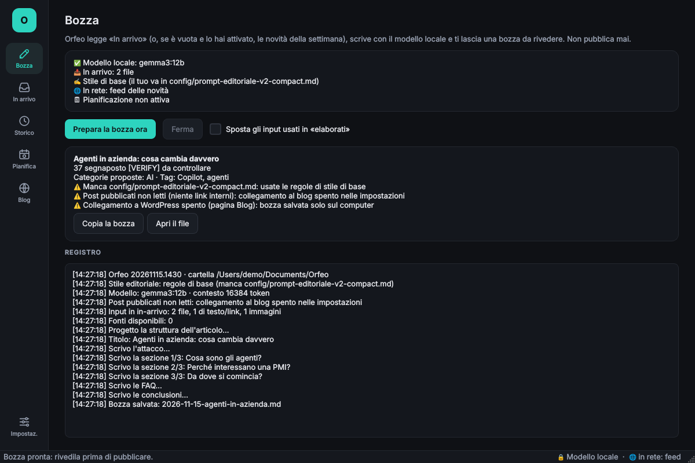
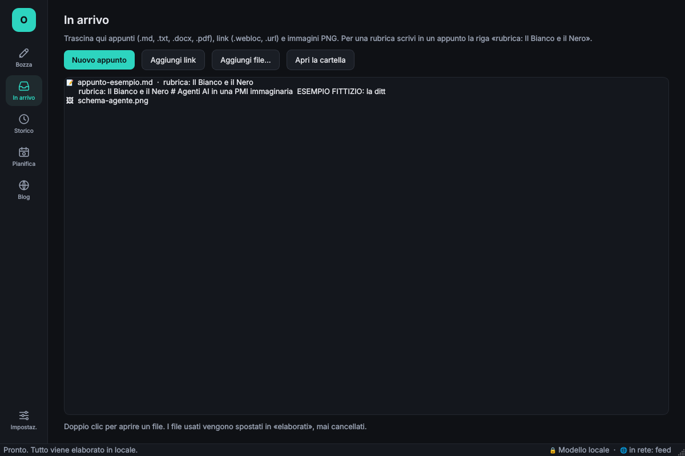
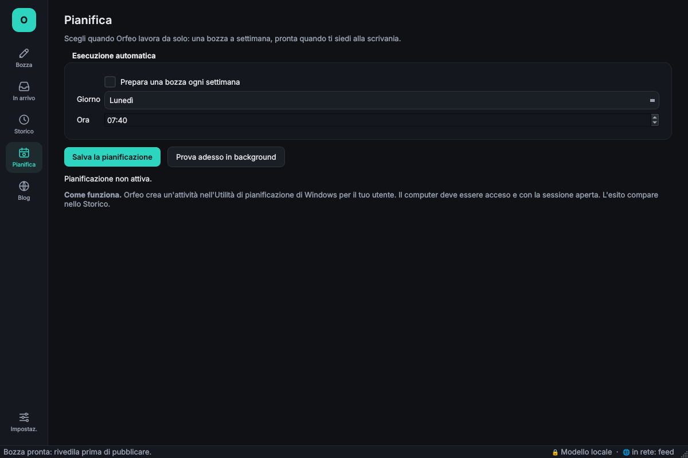

# Orfeo · l'agente editoriale di argosnewdreams.blog

**Ogni settimana una bozza di articolo scritta da un modello linguistico che gira sul tuo computer. Pubblichi tu, sempre.**
*A local, scheduled blog-drafting agent: Ollama on your computer, drafts only, no invented links. English summary below.*

Fa parte della famiglia [Argo](https://github.com/Argo-s-new-dreams/argo-ai): stessa interfaccia «Studio», stesso installer, aggiornamenti dall'app.



## Funzionalità

| Pagina | Cosa fa | Motore |
| --- | --- | --- |
| **Bozza** | Prepara la bozza: piano, attacco, sezioni, FAQ, conclusioni; registro passo per passo, riepilogo con i [VERIFY] da controllare, copia in Markdown | LLM via Ollama |
| **In arrivo** | Il materiale del prossimo articolo: appunti, link, .docx, .pdf, immagini PNG (anche trascinandoli); riga `rubrica:` per le rubriche | Locale |
| **Storico** | Tutte le esecuzioni, manuali e pianificate, con link alla bozza e registro | Locale |
| **Pianifica** | Esecuzione settimanale automatica: launchd su macOS, Utilità di pianificazione su Windows | Sistema operativo |
| **Blog** | Cartella di lavoro, lunghezza e stile; accessi in rete **facoltativi** (link, feed, WordPress) | — |
| **Impostazioni** | Tema, modello Ollama, aggiornamenti | — |

La struttura di ogni bozza: **TL;DR**, sezioni H3 formulate come domande, **FAQ** in H4, **Conclusioni**, **Riferimenti** con il livello della fonte, **nota di trasparenza** (art. 50 AI Act). Lo stile personale si mette in `config/prompt-editoriale-v2-compact.md`, dentro la cartella di lavoro.

| In arrivo | Blog | Pianifica |
| --- | --- | --- |
|  |  |  |

## Le garanzie sono nel codice, non nel prompt

- **Solo bozze.** Il modulo WordPress sa creare solo post con `status: draft`: non c'è codice per pubblicare, programmare, modificare o cancellare.
- **Nessun link inventato.** Il modello cita le fonti come `[S1]`, `[S2]`; i Riferimenti li compone Python con le pagine scaricate davvero durante l'esecuzione. Ogni altro URL scritto dal modello viene tolto e sostituito da `[VERIFY: link rimosso perché non verificato]`; una citazione inesistente diventa `[VERIFY: fonte]`.
- **Fonti classificate.** Livello 1 fonte ufficiale primaria (EUR-Lex, Microsoft Learn, istituzioni), Livello 2 ricerca accademica (arXiv, DOI, ACM, IEEE), Livello 3 annuncio ufficiale del vendor. Le fonti non classificate sono marcate `[VERIFY]`.
- **Niente si cancella.** Gli input usati vengono spostati in `elaborati/AAAA-MM-GG/`.
- **[VERIFY] dove serve il tuo occhio:** dati mancanti, esperienze personali, nomi di clienti, immagini da caricare (con didascalia proposta), formulazione della nota di trasparenza. In WordPress sono evidenziati.

## Il "cervello" testuale: Ollama

Orfeo scrive con un modello locale servito da [Ollama](https://ollama.com) su `localhost`. Per un Mac da 16 GB:

```bash
ollama pull gemma3:12b   # circa 8 GB
```

Si può scaricare anche da *Impostazioni → Nuovo modello*. Con gemma3:12b su un Mac M4 una bozza richiede in genere qualche minuto. Se Ollama è chiuso, Orfeo prova ad aprirlo da solo.

## Requisiti

| Sistema | Supporto |
| --- | --- |
| macOS Apple Silicon (M1 o successivi), 16 GB consigliati | Sì: notifiche nel Centro notifiche, pianificazione con launchd |
| Windows 10/11 x64 | Sì: pianificazione con l'Utilità di pianificazione, esito nello Storico (niente notifica) |
| Windows 11 ARM | Sì, con Python x64 in emulazione |
| macOS Intel, Linux | No |

## Installazione

1. **Scarica** il repository (`Code → Download ZIP`) ed estrailo.
2. **Avvia l'installer**
   - macOS: tasto destro su `Installa-Mac.command` → *Apri*. Se macOS lo blocca: *Impostazioni di Sistema → Privacy e sicurezza → Apri comunque*.
   - Windows: doppio clic su `Installa-Windows.bat`. Se compare SmartScreen: *Ulteriori informazioni → Esegui comunque*.
3. **Apri Orfeo**, in *Impostazioni* scegli il modello; nella pagina *Blog* attiva solo gli accessi in rete che ti servono.
4. Prima bozza a mano da **Bozza → Prepara la bozza ora** (su Mac rispondi «Consenti» se chiede l'accesso a Documenti), poi attiva la **Pianificazione** (di serie lunedì alle 7:40).

Gli installer non sono firmati digitalmente: per questo Windows e macOS mostrano un avviso. Il codice è tutto qui, leggibile.

🆕 **Novità:** [CHANGELOG.md](CHANGELOG.md) · 📖 **Manuale:** [docs/MANUALE.md](docs/MANUALE.md)

## Privacy e dati

- Il modello gira sul computer: **appunti e bozze non vengono mai inviati a un servizio di AI.**
- Di serie Orfeo **non va in rete** (a parte il controllo degli aggiornamenti su GitHub, disattivabile). Nella pagina *Blog* puoi accendere, uno per uno:
  - **Leggi i link** degli appunti: scarica quelle pagine per citarle come fonti;
  - **Novità dai feed**: legge i feed ufficiali (di serie Microsoft 365 Roadmap e arXiv cs.AI, cs.CL) quando *In arrivo* è vuota;
  - **WordPress**: legge i post pubblicati (per i link interni) e invia la **bozza** al tuo blog. Si autentica con una *password applicazione* salvata nel portachiavi del sistema (Portachiavi su macOS, Gestore credenziali su Windows).
- Quando un accesso è acceso, il bollino in basso lo dichiara: «🔒 Modello locale · 🌐 in rete: …».
- Impostazioni, storico e registri stanno in `~/orfeo-env/dati/`; appunti e bozze nella cartella di lavoro (di serie `~/Documents/Orfeo`). Gli aggiornamenti non li toccano.

### AI Act

Orfeo è uno strumento di supporto alla scrittura: l'autore resta la persona che rivede e pubblica.

- **Art. 50(4), Regolamento (UE) 2024/1689:** chi diffonde testo generato o manipolato dall'AI per informare il pubblico su questioni di interesse pubblico deve dichiararlo, salvo che il testo sia stato sottoposto a revisione umana o controllo editoriale e una persona ne abbia la responsabilità editoriale. Orfeo aggiunge comunque una nota di trasparenza in fondo a ogni bozza, da adattare.
- **Art. 4 (alfabetizzazione in materia di AI):** il registro passo per passo, i [VERIFY] e i livelli delle fonti aiutano a capire cosa ha fatto il modello e dove serve il controllo umano.
- Nessuna funzione rientra fra le pratiche vietate dall'art. 5.

*Queste note non sono consulenza legale.*

## Struttura

```
app/
  progetto.py            identità dell'app (nome, versione, impostazioni di base)
  main.py                finestra, menu, Impostazioni, aggiornamenti, avvio senza finestra
  pagina_bozza.py        Bozza          pagina_arrivo.py     In arrivo
  pagina_storico.py      Storico        pagina_pianifica.py  Pianifica
  pagina_blog.py         Blog (cartella, scrittura, rete facoltativa)
  motore.py              il lavoro di Orfeo, senza interfaccia
  fonti.py               feed RSS/Atom, lettura pagine, livelli delle fonti
  ingressi.py            lettura di appunti, documenti, link, immagini
  gutenberg.py           da Markdown a blocchi Gutenberg
  wordpress.py           post pubblicati e creazione di bozze (solo draft)
  pianificazione.py      launchd (macOS) e Utilità di pianificazione (Windows)
  comune.py              cartelle, rete, password, storico, notifiche
  tema.py, pagine.py, lavoro.py, dati.py, llm_locale.py, aggiornamenti.py   standard famiglia Argo
docs/                    manuale e screenshot
strumenti/               versione, icone, verifica pre-pubblicazione
```

## Stato del progetto

Prima versione. Provata con un server Ollama e un WordPress simulati; da collaudare sul Mac M4 e sul PC Windows ARM con Ollama, gemma3:12b e il blog reale.

## Licenza

MIT. Licenze di terze parti in [THIRD_PARTY_LICENSES.md](THIRD_PARTY_LICENSES.md).

## English summary

Orfeo is a local desktop app (macOS Apple Silicon and Windows) that prepares one blog post draft per week. It reads notes, documents and links from an inbox folder, or optionally picks a topic from official RSS feeds of the last 7 days, and writes with a local LLM through Ollama. Network access (fetching linked pages, reading feeds, sending the draft to WordPress) is optional and off by default. WordPress posts are created as **drafts only**. References are built by code from pages actually fetched during the run; any URL produced by the model that is not one of them is removed and flagged `[VERIFY]`. Scheduling uses launchd on macOS and Task Scheduler on Windows.
